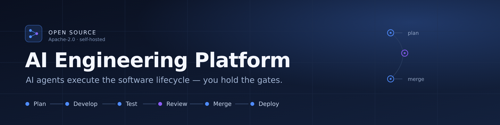

<p align="center">
  
</p>

<h1 align="center">AI Engineering Platform</h1>

<p align="center">
  <b>AI agents run the software lifecycle — you hold the gates.</b><br/>
  From a task to a merged pull request: plan, code, test, review and deploy with a human at every checkpoint and a full audit trail.
</p>

<p align="center">
  <a href="LICENSE"></a>
  <a href="https://github.com/gjovanovicst/ai-engineering-platform/releases"></a>
  <a href="https://github.com/gjovanovicst/ai-engineering-platform/actions/workflows/ci.yml"></a>
  
  
</p>

## What it is

A **self-hosted** platform where AI agents execute the software lifecycle. You give
the platform a task with acceptance criteria; agents plan, implement in a
network-isolated sandbox, test, review and open a pull request. You approve the
plan and the pull request. Everything in between is recorded.

- **Agents that ship** — planning, development, review and follow-up runs over a
  real repository, not a chat window.
- **Gates you control** — plan approval, test gate, secret scan, agent review and
  the human pull-request approval. The platform never merges on its own.
- **Evidence, not claims** — every run keeps its diff, test report, acceptance
  proof, review findings and an append-only event stream.

## How it works

| Step | Who | Output |
|---|---|---|
| 1. Task | you | a task with acceptance criteria |
| 2. Plan | planning agent | steps, files, risks — **you approve** |
| 3. Develop | development agent | code in a sandbox, tests run, a pull request |
| 4. Gates | platform | test gate, secret scan, agent review findings |
| 5. Merge | **you** | the pull request is merged; the task closes |

The same process the platform sells is the one it is built with; see
[docs/01-asdlc.md](docs/01-asdlc.md).

## Quickstart

```sh
git clone https://github.com/gjovanovicst/ai-engineering-platform.git
cd ai-engineering-platform && cp .env.example .env
make keygen && docker compose up -d postgres redis minio mailhog keycloak
make migrate-up && make sandbox-image
make run-api && make run-worker && make web-dev
```

Open <http://localhost:3000>, register, create a project and connect a repository.
Full setup, provider keys and GitHub PAT scopes: **[docs/quickstart.md](docs/quickstart.md)**.

## What's in v0.1.0

- Plan approval, test gate, secret scanner, agent review and human PR approval.
- Live run page: events, diff, test report, usage, failure detail and retry.
- Per-repository git credentials; Go module fetch for the offline sandbox.
- GitHub and GitLab, OIDC/SSO, analytics, invites, tracing.
- Signed images (cosign), SBOM and provenance on every release.

## Documentation

| Read | Why |
|---|---|
| [Quickstart](docs/quickstart.md) | run it locally in ten minutes |
| [ASDLC](docs/01-asdlc.md) | the lifecycle, gates and artifacts the platform implements |
| [Architecture](docs/02-architecture.md) | Go packages, agent runtime, sandbox, providers |
| [API](docs/04-api.md) · [OpenAPI](api/openapi.yaml) | the HTTP contract |
| [Runbook](docs/14-runbook.md) · [Security](docs/15-security.md) | operating and threat model |
| [User guide](site/docs/) | setup, projects, tasks, runs, approvals |

Every document: **[docs/README.md](docs/README.md)**.

## Status and roadmap

- **v0.1.0** — developer preview, self-hosted (current).
- **v0.1.1** — self-hosting readiness: per-project test command, web dependencies
  in the sandbox, review/CI fix runs, retry with the same plan, `aipctl seed`.
- **v0.2.0** — UX + assistant (the task composer, guidance, the AI assistant).
- **v0.3.0 → v1.0.0** — design 2.0, multi-stack, the flow, agent quality,
  production, GA. The full plan: [ROADMAP.md](ROADMAP.md).

The status is deliberately honest: the core ASDLC is verified, while some
operational features are not production-ready yet. See
[docs/54-status.md](docs/54-status.md) and [CHANGELOG.md](CHANGELOG.md).

## Contributing, security, license

Licensed under [Apache-2.0](LICENSE). Contributions under the Developer
Certificate of Origin — see [CONTRIBUTING.md](CONTRIBUTING.md) and
[CODE_OF_CONDUCT.md](CODE_OF_CONDUCT.md). Report vulnerabilities privately via
[SECURITY.md](SECURITY.md); governance is in [GOVERNANCE.md](GOVERNANCE.md).
